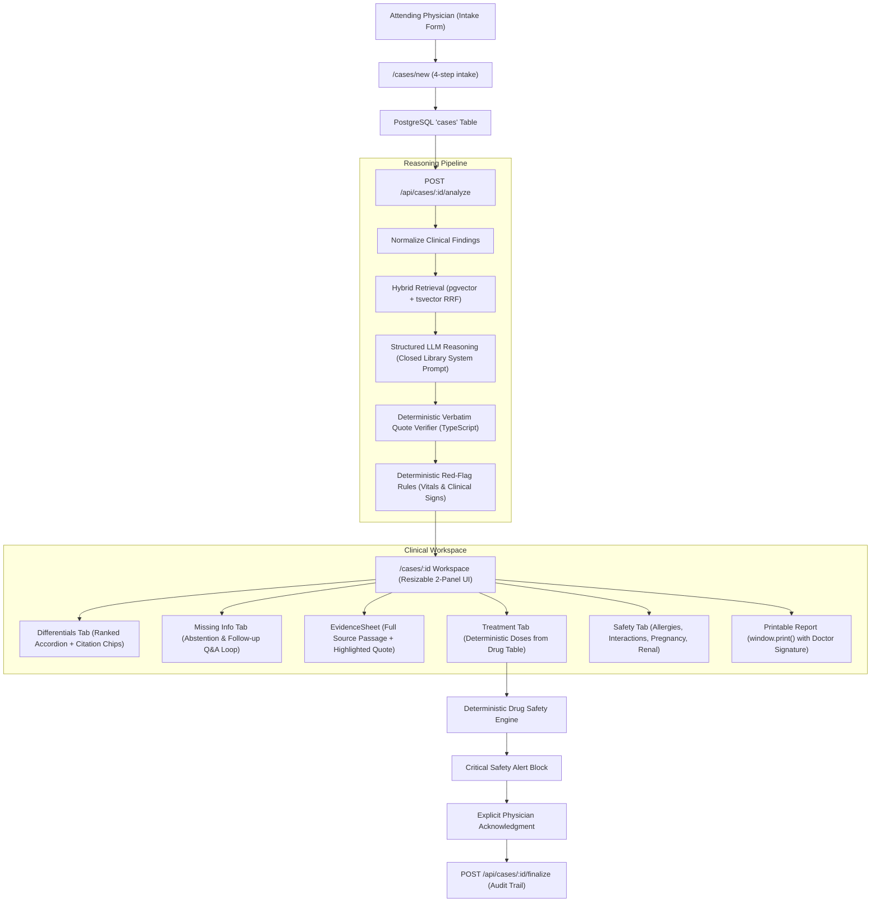

# DocMate AI (ডকমেট এআই)
### Clinical Decision Support Assistant with Verbatim Citation Verification & Deterministic Drug Safety

> **Important Clinical Disclaimer**:
> **Clinical decision support only. Not a substitute for professional judgement.**
> *(শুধুমাত্র ক্লিনিকাল সিদ্ধান্ত সহায়তা। পেশাদার মূল্যায়নের বিকল্প নয়।)*

---

## 1. Overview & Core Philosophy

**DocMate AI** is an evidence-based clinical decision support assistant designed specifically for physicians, medical residents, and clinical researchers. 

Unlike generic LLM wrappers that hallucinate facts and speculate on drug dosages, DocMate AI is built around **strict medical safety rules**:

1. **Closed Library Only**: The AI has zero external web access and zero ungrounded outside knowledge. The reasoning engine operates strictly over retrieved passages from our internal peer-reviewed medical guideline library.
2. **Verbatim Code-Verified Citations**: Every diagnostic claim, clinical rationale, and guideline reference must carry a citation to a specific library chunk ID with an exact verbatim quote. Deterministic TypeScript code verifies that the quote exists in the chunk using whitespace-normalized matching before rendering.
3. **Abstention by Design**: If clinical parameters are incomplete or evidence is insufficient to safely differentiate conditions, the assistant returns status `insufficient_evidence` alongside concrete clarifying inquiries (physical exams, diagnostic tests, history). It never guesses.
4. **Deterministic Dosage & Safety Engine**: Drug dosages, frequencies, routes, contraindications, and interaction alerts originate **strictly from structured database tables and pure deterministic TypeScript algorithms**—never from generative LLM text.
5. **Doctor Decides, AI Suggests**: The physician retains complete legal and clinical authority. Critical safety alerts (e.g. fatal drug interactions, pregnancy contraindications) require explicit physician acknowledgment before prescriptions can be finalised and printed.
6. **Bilingual by Design (Bengali Default & English)**: Complete native localization with zero missing keys, specialized Bengali medical typography (~1.7 line height via Noto Sans Bengali), and standard clinical terms formatted with English in brackets (e.g. *"জ্বর (Fever)"*, *"নিউমোনিয়া (Pneumonia)"*).

---

## 2. 5-Step Quickstart

### Prerequisites
- **Node.js** >= 20.x
- **pnpm** >= 9.x
- **PostgreSQL** >= 16 with `pgvector` extension enabled

### Step 1: Clone & Configure Environment
```bash
git clone <repo-url> docmate-ai
cd docmate-ai
cp .env.example .env
```
Ensure `.env` contains your database URL and model settings:
```env
DATABASE_URL=postgresql://apple@localhost:5432/docmate
OPENAI_API_KEY=your_openai_key_here
OPENAI_CHAT_MODEL=gpt-4o-mini
OPENAI_EMBED_MODEL=text-embedding-3-small
```
*(Note: If `OPENAI_API_KEY` is omitted, the system seamlessly uses deterministic synthetic medical fallbacks with identical verification guarantees so offline hackathon demos work without external network dependencies).*

### Step 2: Install Dependencies
```bash
pnpm install
```

### Step 3: Run Database Ingestion
Ingests peer-reviewed clinical guidelines from `data/library/` into chunked passages with pgvector embeddings and PostgreSQL `tsvector` full-text search indexes:
```bash
pnpm run ingest
```

### Step 4: Seed Formulary Drugs, Interactions & Synthetic Cases
Populates the database with 25+ structured drugs with deterministic dosage rules, pairwise drug interactions, and 3 synthetic demo patient cases (`P-101`, `P-102`, `P-103`):
```bash
pnpm run seed
```

### Step 5: Build & Launch
```bash
# Production mode
pnpm run build
pnpm start -p 3000

# Or development mode with hot reload
pnpm run dev
```
Visit `http://localhost:3000` in your browser. (The root URL automatically redirects to `http://localhost:3000/bn`).

---

## 3. Seeded Demo Accounts

You can sign in with any of the pre-seeded clinical personas:

| Role | Email | Password | Permissions |
| :--- | :--- | :--- | :--- |
| **Doctor (Physician)** | `doctor@docmate.ai` | `demo1234` | Full clinical workspace, differential analysis, treatment planning, prescription finalization |
| **Student** | `student@docmate.ai` | `demo1234` | Case reading, library research, Ask the Library Q&A |
| **Researcher** | `researcher@docmate.ai` | `demo1234` | Library search, audit log inspection, Q&A |
| **Admin** | `admin@docmate.ai` | `demo1234` | Source upload, formulary management, system settings |

---

## 4. Seeded Synthetic Patient Cases

The system includes three realistic, synthetic patient test cases designed to exercise the clinical reasoning engine:

- **Case 1: `P-101` (Adult Fever with Productive Cough)**
  - 45-year-old male with high fever, rust-colored sputum, and right pleuritic chest pain.
  - Demonstrates: Community-Acquired Pneumonia (CAP) differentiation, CRB-65 severity triage, verified citations to WHO/National ARI guidelines, deterministic Amoxicillin dosing.
- **Case 2: `P-102` (Acute Chest Pain with Critical Red Flags)**
  - 58-year-old male with crushing substernal chest pain radiating to left arm and jaw, diaphoresis, and borderline BP.
  - Demonstrates: Deterministic emergency red-flag escalation, Acute Coronary Syndrome triage, STAT 12-lead ECG & cardiac troponin testing requirement.
- **Case 3: `P-103` (Vague Malaise / Insufficient Evidence)**
  - 32-year-old female with vague fatigue and mild headache without objective vitals or exam findings.
  - Demonstrates: **Abstention by Design** — the system refuses to guess, returns `insufficient_evidence`, and prompts the physician with specific clarifying follow-up inquiries.

---

## 5. System Architecture



---

## 6. How to Add New Medical Guidelines to the Library

To expand the internal knowledge base with real clinical textbooks or national protocols:

1. Place your guideline Markdown files (`.md`) or text files into `data/library/`.
2. Format headings using standard Markdown (`# Title`, `## Section 1: ...`).
3. Run the ingestion script:
   ```bash
   pnpm run ingest
   ```
   The script splits files by section into ~400–700 token chunks with 10% overlap, computes vector embeddings in batches, and updates the PostgreSQL full-text `tsvector` index. Existing unchanged chunks are skipped automatically via SHA-256 hash checks.

---

## 7. Testing & Verification

### Running Vitest Unit Tests
Tests citation whitespace normalization, verbatim matching, dropping unverified claims, drug safety engine rules (allergies, interactions, pregnancy, eGFR, age), and 100% i18n key parity:
```bash
pnpm test
```

### Running Playwright Smoke E2E Tests
Tests demo login, case workspace rendering, and bilingual disclaimer persistence:
```bash
pnpm run test:e2e
```

### Code Quality & Compilation
```bash
pnpm run lint
pnpm run typecheck
pnpm run build
```

---

## 8. License & Standards
Built for hackathon demonstration purposes. Designed in strict compliance with clinical decision support principles. No real patient data (PHI) is used.
